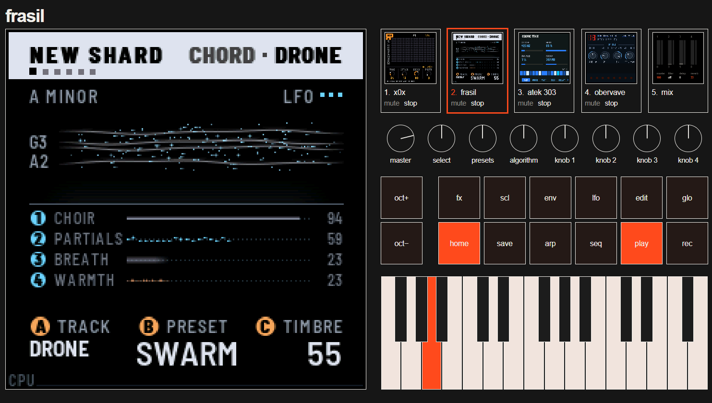

  

# Luka

**Play community firmwares for the M-VAVE FM-1 pocket synth, right in your browser, no hardware needed.**

Pick a firmware, and it plays with the device's real screen, keys, knobs and sound. Load up to **four at once**,
each on a screen of its own, and jam: a drone under a drum machine under a lead, all running together.

### [▶ Open Luka: kamil-in.github.io/luka](https://kamil-in.github.io/luka/)

No install, no account, nothing to download first. Best in **Chrome or Edge** on a computer. Works with a
**MIDI keyboard or controller** too, if you have one.

  <b><a href="#start-jamming-in-a-minute">Start jamming</a></b> &nbsp;·&nbsp;
  <a href="#playing">Playing</a> &nbsp;·&nbsp;
  <a href="#what-to-play">What to play</a> &nbsp;·&nbsp;
  <a href="#using-a-midi-keyboard-or-controller">MIDI controllers</a> &nbsp;·&nbsp;
  <a href="#troubleshooting">Troubleshooting</a> &nbsp;·&nbsp;
  <a href="#credits">Credits</a> &nbsp;·&nbsp;
  <a href="#building-it-yourself">Build it yourself</a>

Sections marked with ▸ open and close when you click them.

---

## Start jamming in a minute

1. **Open** [kamil-in.github.io/luka](https://kamil-in.github.io/luka/).
2. Click the **menu button** (three lines, top left) to open the list of firmwares. There are 32.
3. Press **load** next to one. It fills the first free screen and starts.
   Some firmwares **play by themselves** the moment they start (the ambient and generative ones); Luka loads those
   **stopped** so they do not surprise you. Press **play** on their screen when you want them.
4. **Play it**: click the keys on screen, or type on your computer keyboard (see below). Turn a knob by scrolling the mouse
   wheel over it, or by dragging it up and down.
5. **Add more**: open the list again and load another firmware onto the next screen. Everything keeps playing.

If you hear nothing: browsers only start sound after you click or press something on the page, so click once
and try again. Then check the screen's **mute** isn't on, its firmware isn't **stopped**, and the **master** knob (the
first one, the firmware's volume) isn't at zero.

---

## Playing

<b>Four screens, one front panel</b>

* Each screen shows one firmware's display. Its bar has the firmware's name, **mute** (silences it, keeps it running)
  and **stop / play** (holds it exactly where it is, silent; play lets it carry on).
* The **front panel** below belongs to the **chosen screen**, the one outlined in orange. Click a screen, or press
  <kbd>1</kbd> to <kbd>4</kbd>, to choose another. Whatever you were holding is let go, and the others keep playing.
* The panel is greyed out while the chosen screen is empty or its firmware is stopped.

<b>The panel</b>

* **Keys**: 27 of them. Click one (the lower on the key, the harder you hit it), or type on your keyboard:
  <kbd>a</kbd> <kbd>s</kbd> <kbd>d</kbd> <kbd>f</kbd> <kbd>g</kbd> <kbd>h</kbd> <kbd>j</kbd> <kbd>k</kbd> <kbd>l</kbd> <kbd>;</kbd> <kbd>'</kbd>
  are the white keys from C4, and <kbd>w</kbd> <kbd>e</kbd> <kbd>t</kbd> <kbd>y</kbd> <kbd>u</kbd> <kbd>o</kbd> <kbd>p</kbd>
  are the black keys above them. <kbd>z</kbd> and <kbd>x</kbd> move the octave down and up.
* **Knobs**: 8 of them. The first (**master**) is the firmware's volume; the rest do whatever the firmware
  gives them (the labels are the real FM-1's: select, presets, algorithm, knob 1 to 4).
* **Buttons**: 14, with the real device's labels (`oct-`, `oct+`, `fx`, `scl`, `env`, `lfo`, `edit`, `glo`, `home`,
  `save`, `arp`, `seq`, `play`, `rec`). Each firmware uses them in its own way, so read its page (the **source**
  button beside it in the list opens it) to learn what they do.
* **Saving**: what a firmware saves is kept in your browser, so it is still there next time you load it.

<b>The firmware list</b>

* **Search** by name or repository (which includes the author's handle); every word you type has to match. The **×** clears it (so does <kbd>Esc</kbd>;
  <kbd>Esc</kbd> again closes the list).
* **load** puts a firmware on the chosen screen if that is empty, otherwise on the first empty one.
  With all four screens taken, **unload** one first. **unload** takes a firmware off its screen.
* A firmware lives on one screen at a time.
* The first time you load a firmware it is downloaded (the biggest is about a megabyte); your browser remembers the ones
  you have used, so they load instantly next time.
* The **light / dark** button in the bar switches the look; without a choice it follows your system.

---

## What to play

Thirty-two firmwares from the FM-1 community, each with its own character. A few ideas to start (each description is a
summary of what that project says about itself; follow the link in [Credits](#credits) for the real thing):

| If you want... | Try |
|---|---|
| **Ambient beds and drones** | AMB-1, Niagara Drift, FRASIL (frozen drones with shimmer reverb), Aisling (dream-harp soundscapes), SATIE-1 (Satie-inspired generative piano), GR!MM, Arctic Scream, Demake (an ambient lofi machine on pedal recordings) |
| **Beats and bass** | X0X (a 303 bass synth with 808 and 909 drum machines), FMini-1 (a 4-track groovebox), Melodee (909 drums, a sequencer), ATEK 303, LOAF BREAKER (hardcore kicks and chopped breaks), PERF-1 (a groovebox that plays itself while you steer it), JAMTRACK (a backing band that follows your chords) |
| **A lead to play over it** | MONK-1 (a velocity-sensitive monophonic synth that talks), FiMba-1 (an electric kalimba), ZEN-1 (koto, shakuhachi, erhu, with microtones), S1Vave and OberVave (analogue-modelling synths), OG Synth, JIANT, Golana, M-PYRE (a rock and metal riffbox with guitar samples), Chimera Vocal (a singing human voice) |
| **Something to wander through** | Nachtfahrt (a Berlin-school night drive), Loom (a generative pattern weaver), Mutable Dreams (over 50 oscillator models), CoralFlower (a live arpeggiator), Skiff (a modular patch environment), Blop (one-finger chords and an aquarium), viscera (a four-track tape looper) |

<b>Jam recipes</b>

* **Drone and lead.** Screen 1: Niagara Drift or AMB-1 (press **play**). Screen 2: MONK-1 or FiMba-1. Choose screen 2 and play over
  the drone; lower the drone with its **master** knob or **mute** it between sections.
* **A little band.** Screen 1: X0X for the beat. Screen 2: a bass or lead. Screen 3: a pad or drone. Screen 4: whatever
  surprises you. Switch between them with <kbd>1</kbd> to <kbd>4</kbd> while they all play.
* **Stop to build tension.** **stop** a screen to drop it out exactly where it is, then **play** to bring it back in on
  the same spot.
* **Layer on the same notes.** The panel plays only the chosen screen, but you can play a line on one, switch, and play
  another over the top while the first carries on (the generative firmwares keep going by themselves).

---

## Using a MIDI keyboard or controller

Luka works with any MIDI controller: it **learns** yours instead of expecting a particular make.

1. **Plug it in** (before or after opening Luka) and use **Chrome or Edge**. Allow MIDI when the browser asks.
2. The **midi** button in the bar goes solid when a controller is connected.
3. **Play the keys.** Notes play the panel's keys straight away, with nothing to set up. A note outside the panel's range is
   moved by whole octaves until it fits (so it is still the same note), so a small keyboard plays whatever octave it is on.
4. **Teach it the other controls.** Click **midi**, then **learn** beside a control and press that button or turn that knob on
   your controller. It is learned the moment Luka hears it. **learn all** walks through them in order.

<b>What each learnable control does</b>

| Control | What it does |
|---|---|
| **navigation left / right** | Choose the previous / next screen that has a firmware |
| **master, select, presets, algorithm, knob 1 to 4** | The panel's 8 knobs |
| **play** | Play / stop the chosen screen |
| **Firm** | Opens the firmware list. With the list open, loads the highlighted firmware (or unloads it, if it is on a screen) and closes the list |
| **list knob** | Moves the highlight up and down the list while it is open |

A knob can be a position knob (a pot) or an endless one (an encoder); Luka works out which from how you turn it, so turn it
a good way clockwise when you learn it. What it learns is kept in your browser. **reset** forgets it all, and the panel also
shows the last message your controller sent, which helps if something does not respond.

---

## Troubleshooting

<b>Common problems and what to try</b>

| Problem | Try |
|---|---|
| No sound | Click the page once (browsers wait for that), check **mute**, that the firmware is not **stopped**, and the **master** knob |
| The panel is greyed out | The chosen screen is empty or its firmware is stopped: load one, or press **play** |
| Crackling with several firmwares | Close other heavy tabs; each firmware is light (about 1% of a core), but audio is sensitive |
| The **midi** button stays dim | Use Chrome or Edge, allow MIDI for the site when asked, then reload or replug the controller |
| A firmware did not start | The status line (top right) says why; try loading it again, or reload the page |

---

## Credits

Luka is only a player. **Everything you hear was made by other people**, and this project exists thanks to them.

<b>The firmwares</b>

Each firmware is the work of its author, published as open source for the **M-VAVE FM-1**. Luka plays the **browser
build each author published**, unmodified, under that author's own licence. Please visit their projects, star them, read their
manuals, and support them.

| Firmware | Author | Licence | Project |
|---|---|---|---|
| Aisling | Stephen Cummins | GPL-3.0 | [stephencummins/fm1-aisling](https://github.com/stephencummins/fm1-aisling) |
| AMB-1 | Charles Vestal | MPL-2.0 | [charlesvestal/fm1-amb](https://github.com/charlesvestal/fm1-amb) |
| Arctic Scream | PolarPatch | GPL-3.0 | [PolarPatch/Arctic-scream-FM-1](https://github.com/PolarPatch/Arctic-scream-FM-1) |
| ATEK 303 | animatek | GPL-3.0 | [animatek/FM1-Animatek](https://github.com/animatek/FM1-Animatek) |
| Blop | Obsimo | GPL-3.0 | [OSR-Experiment/OSR-1](https://github.com/OSR-Experiment/OSR-1) |
| Chimera Vocal | Shan-Sherif (a port of Jameson Hodge's CHIMERA) | MIT / MPL-2.0 / GPL-3.0 (per file) | [shan-sherif/fm-1-chimera-vocal](https://github.com/shan-sherif/fm-1-chimera-vocal) |
| CoralFlower | FicusFicusov | GPL-3.0 | [FicusFicusov/CoralFlower](https://github.com/FicusFicusov/CoralFlower) |
| Demake | Iñigo Hernández | GPL-3.0 | [InigoHernandez/demake-synth](https://github.com/InigoHernandez/demake-synth) |
| FiMba-1 | J. Adam Sowers | GPL-3.0 | [jadamsowers/fm1-fimba](https://github.com/jadamsowers/fm1-fimba) |
| FMini-1 | Leo Kuroshita ([@kurogedelic](https://github.com/kurogedelic)), Hügelton Instruments | GPL-3.0 | [ruppert/fmini-1](https://github.com/ruppert/fmini-1) |
| FRASIL | Styves Goupil | MPL-2.0 / GPL-3.0 | [styvesgoupil/frasil](https://github.com/styvesgoupil/frasil) |
| Golana | Gadlele | GPL-3.0 | [Gadlele/Golana](https://github.com/Gadlele/Golana) |
| GR!MM | GRiMMBIENT | GPL-3.0 | [GRiMMBIENT/grimm](https://github.com/GRiMMBIENT/grimm) |
| JAMTRACK | PhilipsKnobs | MIT | [Philip-Bos/jamtrack-fm1](https://github.com/Philip-Bos/jamtrack-fm1) |
| JIANT | juanjiant-bit | GPL-3.0 | [juanjiant-bit/JIANT](https://github.com/juanjiant-bit/JIANT) |
| LOAF BREAKER | FLEXOR | MPL-2.0 | [FLEXOR-R/loaf-breaker](https://github.com/FLEXOR-R/loaf-breaker) |
| Loom | Charles Vestal | GPL-3.0 | [charlesvestal/fm1-loom](https://github.com/charlesvestal/fm1-loom) |
| M-PYRE | History Of Sky | GPL-3.0 | [HistoryOfSky/m-pyre](https://github.com/HistoryOfSky/m-pyre) |
| Melodee | Kerem Kilic ([@keremimo](https://github.com/keremimo)) | GPL-3.0 | [keremimo/melodee](https://github.com/keremimo/melodee) |
| MONK-1 | Charles Vestal | GPL-3.0 | [charlesvestal/fm1-monk](https://github.com/charlesvestal/fm1-monk) |
| Mutable Dreams | Henri David (kidbee85) | GPL-3.0 / MPL-2.0 | [kidbee85-beep/mutable-dreams](https://github.com/kidbee85-beep/mutable-dreams) |
| Nachtfahrt | FartyPants | GPL-3.0 | [FartyPants/fm1-nachtfahrt](https://github.com/FartyPants/fm1-nachtfahrt) |
| Niagara Drift (OMNI) | Evan Yerburgh | GPL-3.0 | [evanyerburgh/niagara-drift](https://github.com/evanyerburgh/niagara-drift) |
| OberVave | Zvenson | GPL-3.0 | [zvenson/obervave](https://github.com/zvenson/obervave) |
| OG Synth | Mike Johnson Beats | MPL-2.0 | [mikejohnsonbeats/OG-Synth-source](https://github.com/mikejohnsonbeats/OG-Synth-source) |
| PERF-1 | deamonSLINKY | GPL-3.0 | [deamonSLINKY/PERF-1](https://github.com/deamonSLINKY/PERF-1) |
| S1Vave | AndrewGG88 | GPL-3.0 | [AndrewGG88/S1Vave](https://github.com/AndrewGG88/S1Vave) |
| SATIE-1 | OCKM STUDIO | GPL-3.0 | [OCKM-STUDIO/SATIE-1](https://github.com/OCKM-STUDIO/SATIE-1) |
| Skiff | illuminus5 | GPL-3.0 | [illuminus5/skiff](https://github.com/illuminus5/skiff) |
| viscera | De-Pattern | GPL-3.0 | [De-Pattern/viscera](https://github.com/De-Pattern/viscera) |
| X0X | Charles Vestal | GPL-3.0 | [charlesvestal/fm1-x0x](https://github.com/charlesvestal/fm1-x0x) |
| ZEN-1 | aceyprime | GPL-3.0 | [aceyprime/zen-1](https://github.com/aceyprime/zen-1) |

Author names and licences are as recorded when the builds were imported; each project's own page is the authority.
**SLOOP 3** by isod89 (GPL-3.0, [isod89/sloop3-fm1](https://github.com/isod89/sloop3-fm1)) and **JamesOS** by Aaron Grando
(GPL-3.0, [aarongrando/JamesOS](https://github.com/aarongrando/JamesOS)) are followed too, but publish no browser build yet, so
they are not in the app. Two more projects are used for development and testing and are not in the list in the app:
**Felucca** by Hügelton Instruments (GPL-3.0, [hugelton/Felucca](https://github.com/hugelton/Felucca)), the 4-track FM firmware
that Skiff is based on, and whose packages Luka's emulator was tested against.

<b>The platform and the code underneath</b>

* **M-VAVE FM-1**: the pocket synthesizer all of this is written for, by **M-VAVE**.
* **[fm1-emu](https://github.com/joakimeriksson/fm1-emu)** by **Joakim Eriksson** (MIT): the FM-1 emulator that Luka's
  emulator path is built on, including the JIT glue adapted for the browser. Its licence notice is in
  [THIRD-PARTY.md](THIRD-PARTY.md).
* **[Tauri](https://tauri.app)** (Apache-2.0 / MIT): the desktop window.
* **[cpal](https://github.com/RustAudio/cpal)** (Apache-2.0): sound output for the desktop emulator path.
* **[serde](https://serde.rs)**, **serde_json** (MIT / Apache-2.0), **[sha2](https://github.com/RustCrypto/hashes)**
  (MIT / Apache-2.0), **[thiserror](https://github.com/dtolnay/thiserror)** (MIT / Apache-2.0),
  **[ureq](https://github.com/algesten/ureq)** (MIT / Apache-2.0) and **[tiny_http](https://github.com/tiny-http/tiny-http)**
  (MIT / Apache-2.0): the Rust libraries under the tools and the local server.
* The open web platform: **WebAssembly**, **Web Audio** (AudioWorklet) and **Web MIDI**.

Luka is an independent project. It is **not affiliated with or endorsed by M-VAVE or any of the firmware authors**.
If you are an author and want something changed or removed, please open an issue.

---

## Building it yourself

Everything about how Luka is put together, how to run it from source (web and desktop), how to host it, and
how to run the tests is in the **[Technical Documentation](Technical%20Documentation.md)**. MIDI controller internals are in
[`ui/midi/README.md`](ui/midi/README.md).

## License

Luka is released under the **GNU General Public License v3.0** (GPL-3.0-only): see [LICENSE](LICENSE), and
[THIRD-PARTY.md](THIRD-PARTY.md) for third-party notices. The community firmwares remain under their authors' licences,
listed above.
